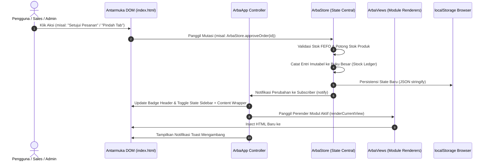

# 01 - Analisis Arsitektur Sistem Vanilla Saat Ini (Current Architecture)

Dokumen ini mendokumentasikan secara menyeluruh spesifikasi teknis, arsitektur berkas, pola eksekusi kode, dan alur data aplikasi **ArbaConnect ERP** dalam kondisi implementasi saat ini berbasis **Pure Vanilla Web Architecture (HTML5 + CSS3 + ES6 JavaScript)**.

---

## 1. Spesifikasi Tumpukan Teknologi Aktif (Active Stack)

ArbaConnect telah bertransisi sepenuhnya menjadi sistem mandiri (*standalone*) tanpa dependensi build:

```
+---------------------------------------------------------------------------------------+
|                                ARBACONNECT ERP RUNTIME                                 |
+---------------------------------------------------------------------------------------+
|  STRUKTUR   : HTML5 Semantik Tunggal (index.html)                                      |
|  STYLING    : Vanilla CSS Modular (tokens, layout, components, utilities, print)       |
|  LOGIKA     : Vanilla ES6 JavaScript (js/data.js, utils.js, store.js, app.js, views/)  |
|  STATE      : Centralized Reactive Store dengan Observer (Pub/Sub) & localStorage      |
|  ASSET CDN  : Google Fonts (Plus Jakarta Sans, Inter) & Material Symbols Outlined     |
|  BUILD TOOL : TIDAK ADA (Zero Build, Zero Node.js, Zero Bundler)                       |
+---------------------------------------------------------------------------------------+
```

### Karakteristik Runtime Utama
1. **Zero-Build & Zero-Dependency**:
   - Tidak memerlukan Node.js, npm, Vite, TypeScript, React, maupun Tailwind compiler.
   - Tidak ada direktori `node_modules` atau tahapan kompilasi `npm run build`.
2. **Double-Click Runnable**:
   - Dapat dibuka langsung melalui protokol berkas lokal ([index.html](file:///home/sam/Code/arbaconnect/arbaconn/index.html)) pada peramban web modern apa pun (Chrome, Edge, Firefox, Safari).
   - Mendukung hosting statis instan via GitHub Pages, Vercel, Netlify, Caddy, Nginx, maupun `python3 -m http.server`.
3. **Pemuatan Skrip Deterministik (Global Namespace Pattern)**:
   - Menghindari masalah CORS peramban saat dibuka secara lokal dengan menggunakan skrip standar berurutan tanpa `type="module"`.
   - Modul terorganisasi rapi di bawah namespace global window:
     - `window.ArbaData`: Master mock data awal.
     - `window.ArbaUtils`: Utilitas pemformatan rupiah, angka, pengaman HTML, dan ekspor CSV.
     - `window.ArbaStore`: Central state store, mutasi bisnis, dan langganan reaktif.
     - `window.ArbaViews`: Kumpulan fungsi perender untuk ke-5 modul tampilan.
     - `window.ArbaApp`: Koordinator aplikasi, perute view, bilah pencarian, modal, dan toast.
4. **Kepadatan Informasi Desktop Enterprise (Zoom 90%)**:
   - Diterapkan secara baku di [`css/tokens.css`](file:///home/sam/Code/arbaconnect/arbaconn/css/tokens.css) melalui aturan `html { zoom: 0.9; }` guna mempertahankan kerapatan UI ERP enterprise setara baseline asli.

---

## 2. Struktur Berkas & Direktori Proyek Aktif

Workspace `/home/sam/Code/arbaconnect/arbaconn` memiliki struktur yang ringkas, bersih, dan 100% aktif:

```
arbaconn/
├── index.html                       # Semantic HTML5 App Shell & Script Pipeline
├── metadata.json                    # Konfigurasi & Manifest Antigravity IDE
├── css/                             # Sistem Styling Vanilla CSS Murni
│   ├── tokens.css                   # Variabel CSS warna, spasi, tipografi, dan tema gelap
│   ├── layout.css                   # Header fixed 64px, sidebar lipat 64/256px, backdrop, footer
│   ├── components.css               # Tombol, badge, kartu KPI, tabel responsif, modal, phone frame
│   ├── utilities.css                # Helper satu-tujuan (spasi, flex/grid, warna, skala tipografi) berbasis token
│   └── print.css                    # Media cetak: Surat Jalan 3-rangkap & struk termal 58mm
├── js/                              # Arsitektur Logika & State Vanilla
│   ├── data.js                      # Master Mock Dataset awal tersanitasi
│   ├── utils.js                     # Format Rupiah, pengaman XSS, pengunduh berkas CSV
│   ├── store.js                     # Centralized Reactive Store (Pub/Sub & localStorage)
│   ├── app.js                       # Controller: navigasi, search dropdown, dark mode, modal/toast
│   └── views/                       # Modul Perender Tampilan Antarmuka
│       ├── executiveDashboard.js    # View 1: Executive Dashboard & Grafik Batang SVG
│       ├── inventoryLedger.js       # View 2: Inventory & Buku Besar Mutasi FEFO
│       ├── b2bCrm.js                # View 3: B2B CRM Directory & Laci Profil Apotek
│       ├── orderApproval.js         # View 4: Antrean Otorisasi Order & Manifest Armada
│       └── fieldSalesPwa.js         # View 5: Simulasi PWA Sales Lapangan (Smartphone Frame)
└── docs/                            # Dokumentasi Arsitektur Sistem Terpadu
    ├── 00_INDEX.md
    ├── 01_CURRENT_SYSTEM_OVERVIEW.md
    ├── 02_DOMAIN_AND_BUSINESS_RULES.md
    ├── 03_DATA_MODELS_AND_MOCK_DATA.md
    ├── 04_VIEWS_AND_UI_COMPONENTS_AUDIT.md
    ├── 05_DESIGN_SYSTEM_AND_TOKENS.md
    ├── 06_VANILLA_PROTOTYPE_BLUEPRINT.md
    └── 07_VANILLA_IMMERSION_REPORT.md
```

---

## 3. Alur Komponen & Siklus Hidup Reaktif (Reactive Store Pipeline)

Arsitektur aplikasi mengadopsi pola **Reactive Store + Observer Pattern** yang menggantikan seluruh fungsi React Context API (`AppContext`):



### Penjelasan Komponen Inti:
1. **[`js/store.js`](file:///home/sam/Code/arbaconnect/arbaconn/js/store.js)**:
   - Mengelola state global tunggal: `currentPath`, `currentRole`, `isOnline`, `isDarkMode`, `isSidebarCollapsed`, `selectedOutletId`, `products`, `ledger`, `outlets`, `orders`, `supplierPOs`, `salesVisits`, `driverManifests`, dan `offlineQueue`.
   - Mengimplementasikan fungsi observer `subscribe(listener)` dan pemancar event `notify()`.
   - **Perutean URL Hash Terpadu**: Mendukung inisialisasi dan sinkronisasi rute via `window.location.hash` (`#executive-dashboard`, `#inventory-stock-ledger`, `#b2b-crm-directory`, `#order-approval-queue`, `#field-sales-pwa-preview`), memungkinkan navigasi tombol Back/Forward browser dan bookmark halaman.
   - **Override Parameter URL**: Mendukung parameter uji visual langsung pada URL seperti `?sidebar=expanded|collapsed` dan `?dark=true|false`.
   - Menyimpan seluruh perubahan data ke `localStorage` (kunci: `arbaconnect_erp_state_v2`) sehingga mutasi data tetap tersimpan saat peramban dimuat ulang.
2. **[`js/app.js`](file:///home/sam/Code/arbaconnect/arbaconn/js/app.js)**:
   - Bertindak sebagai pengatur utama saat event `DOMContentLoaded` dipicu.
   - **Mesin Sinkronisasi Tata Letak Shell (`updateSidebarBadges`)**:
     - Mengatur kelas `.collapsed` / `.expanded` pada `#app-sidebar` sekaligus memperbarui kelas `.sidebar-open` pada `#app-content-wrapper`.
     - Pada desktop (`min-width: 1024px`), transisi `padding-left` (64px $\leftrightarrow$ 256px) menggeser konten secara inline tanpa menutup konten dengan backdrop (`.sidebar-backdrop { display: none !important; }`).
     - Pada layar tablet/mobile (`< 1024px`), sidebar berfungsi sebagai *drawer overlay* berlatar blur, dan otomatis melipat kembali saat tautan modul dipilih.
   - Menghubungkan interaksi bilah header: pencarian 3 kategori instan, penggantian role, toggle sinkronisasi online/offline, dan sakelar tema gelap.
   - Mengelola mekanisme overlay modal (`openModal` & `closeModal`) dengan dukungan penutupan tombol `Escape` dan klik backdrop.
   - Mengelola pemunculan toast umpan balik interaktif dengan durasi otomatis 3,2 detik.
3. **[`js/views/`](file:///home/sam/Code/arbaconnect/arbaconn/js/views)**:
   - Terdiri dari 5 berkas perender terpisah yang menerima kontainer elemen `#main-view-container`.
   - Menghasilkan string HTML semantik berkinerja tinggi lengkap dengan grafik berbasis SVG murni (tanpa ketergantungan Chart.js atau D3).
   - Seluruh tag HTML non-void ditutup secara ketat (`<div></div>`, `<button></button>`) guna mencegah regresi nesting tata letak DOM peramban.

---

## 4. Evaluasi & Perbandingan terhadap Baseline Lama

| Dimensi Arsitektur | Baseline Awal (React + Vite + TS) | Implementasi Saat Ini (Pure Vanilla) | Keuntungan Transisi |
| :--- | :--- | :--- | :--- |
| **Ketergantungan Build** | Memerlukan Node.js, Vite v8, npm scripts | **Nol (Zero-Build)** | Berkas dapat langsung dieksekusi tanpa instalasi lingkungan |
| **Waktu Startup** | Memerlukan dev server `npm run dev` (~2-3 detik) | **Instan (0 detik)** | Cukup klik ganda berkas `index.html` |
| **Ukuran Ruang Disk** | ~250 MB (termasuk `node_modules` & cache esbuild) | **< 1 MB (seluruh berkas)** | Hemat ruang disk hingga >99% |
| **Kompatibilitas Hosting** | Memerlukan Node runner atau static export bundler | **Server statis apa pun** | Sangat mudah didistribusikan via flashdisk, zip, atau web server lokal |
| **Paritas Tampilan** | Baseline asli (Material 3 Deep Teal) | **100% Identik (Pixel-Perfect)** | Menggunakan palet token, font, dan SVG layout yang sama |
| **Paritas Fungsional** | 5 Modul, 10+ Modal, Role switching, FEFO ledger | **100% Lengkap & Interaktif** | Semua fitur berjalan mulus dengan persistensi state lokal |
| **Pembersihan Berkas** | Terdapat sisa berkas setup React/TypeScript | **Pristine & Bersih** | Seluruh berkas tidak terpakai (`src/`, `package.json`, `vite.config.ts`, `tsconfig.json`, `vercel.json`) telah dihapus |
