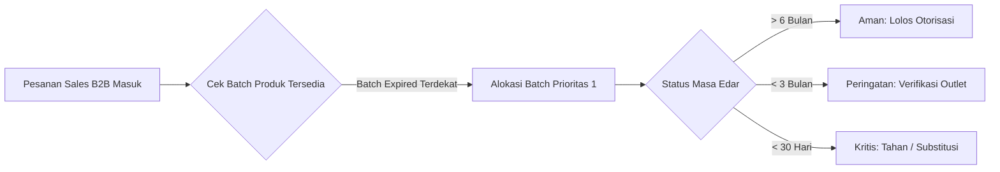

# 02 - Domain Bisnis & Logika Operasional Distribusi

Dokumen ini menjelaskan secara terperinci domain bisnis, regulasi farmasi herbal, rumus perhitungan logistik, serta aturan validasi transaksi yang diterapkan di **CV Arba'in Solo Raya** dan diimplementasikan pada kode Vanilla di [`js/store.js`](file:///home/sam/Code/arbaconnect/arbaconn/js/store.js) dan modul view terkait.

---

## 1. Profil Bisnis & Lingkup Wilayah CV Arba'in

### A. Karakteristik Perusahaan
- **Nama Entitas**: CV Arba'in Solo Raya.
- **Fasilitas Gudang Utama**: Gudang Sentral Kartasura, Sukoharjo, Jawa Tengah.
- **Bidang Usaha**: Manufaktur dan Distribusi Grosir (B2B) Produk Suplemen, Jamu, dan Herbal Alami berstandar BPOM dan Halal.
- **Katalog Kategori Produk**:
  1. **Madu Herbal**: Madu Randu Murni 500g, Madu Randu 250g, Madu Hutan Riau.
  2. **Kapsul Herbal**: Habbatussauda Oil Softgel 100s, Ekstrak Temulawak Curcuma 50s.
  3. **Minyak & Cairan**: Minyak Zaitun Tursina Extra Virgin 60ml, Propolis Trigona Drop 10ml, Minyak Kulit Manggis Plus Sirsak.
  4. **Serbuk**: Kategori tersedia pada filter navigasi untuk ekspansi masa depan.

### B. Geografi Distribusi Wilayah Solo Raya (6 Sub-Rayon)
Sistem membagi jaringan logistik dan rute armada ke dalam 6 wilayah terpadu di Jawa Tengah:
1. **Solo (Kota Surakarta)**: Pusat kota, koridor Slamet Riyadi, Laweyan, Jebres (UNS), Pasar Kliwon.
2. **Sukoharjo**: Solo Baru, Grogol, Kartasura (lokasi gudang utama).
3. **Karanganyar**: Karanganyar Kota, Palur, Jaten, Kebakkramat.
4. **Klaten**: Klaten Tengah, Delanggu, Prambanan.
5. **Boyolali**: Boyolali Kota, Pandanaran, Ampel.
6. **Sragen**: Sragen Kulon, Sukowati, Masaran.

---

## 2. Kepatuhan Regulasi Farmasi & Standar CDOB

Sebagai distributor produk kesehatan dan obat herbal resmi, sistem mengimplementasikan prinsip **Cara Distribusi Obat yang Baik (CDOB)** yang disyaratkan oleh Badan Pengawas Obat dan Makanan (BPOM):

### A. Keterlacakan Batch (Batch Traceability)
- Setiap transaksi penerimaan (*inbound*), pengeluaran (*outbound*), opname (*adjustment*), dan retur (*RMA*) wajib merekam **Nomor Batch Produksi** dan **Tanggal Kedaluwarsa (Expired Date / ED)**.
- Mutasi stok tanpa penunjukan nomor batch yang valid dicegah oleh sistem.

### B. Audit Trail Imutabel & Hash Kriptografis
- Setiap pergerakan stok dicatat ke dalam **Stock Ledger (Buku Besar Stok)** dengan atribut:
  - `id`: Kode unik transaksi (format: `LEDG-XXXXX`).
  - `timestamp`: Stempel waktu presisi dengan penanda waktu WIB.
  - `docRef`: Nomor referensi dokumen legal (PO Supplier, Faktur Pesanan B2B, Berita Acara Opname, atau Retur).
  - `skuName` & `skuCode`: Identitas produk yang dimutasi.
  - `batch`: Nomor batch yang dialokasikan.
  - `type`: Tipe mutasi (`MASUK`, `KELUAR`, `PENYESUAIAN`, `RETUR`).
  - `quantity`: Jumlah unit mutasi (+ untuk masuk, - untuk keluar).
  - `finalStock`: Saldo fisik akhir produk setelah mutasi dieksekusi.
  - `operator` & `operatorRole`: Petugas penanggung jawab (contoh: *Slamet Riadi - Warehouse Inbound*, *Dewi Lestari - Chief Auditor Intern*).
  - `hash`: Nilai hash ringkas SHA-256 (contoh: `c84a...9df2`) sebagai representasi integritas data anti-manipulasi.

---

## 3. Logika Mutasi Stok FEFO (First-Expired, First-Out)

ArbaConnect mewajibkan penegakan prinsip **FEFO** (mendahulukan pengeluaran batch dengan tanggal kedaluwarsa terdekat):

### Kategori Status Masa Edar FEFO:
1. **Aman (> 6 Bulan)**: Produk layak didistribusikan ke seluruh tipe outlet mitra termasuk minimarket dan apotek umum.
2. **Mendekati ED (< 3 Bulan)**: Membutuhkan persetujuan khusus supervisor; diprioritaskan untuk outlet dengan perputaran barang tinggi (*fast-moving*).
3. **Kritis (< 30 Hari)**: Terkunci otomatis dari alokasi pesanan reguler; dialihkan untuk program karantina gudang, cuci gudang (*flash bundle*), atau retur ke pabrik rekanan.

### Mekanisme Pengurangan Stok Saat Otorisasi (`approveOrder`):
Pada implementasi [`js/store.js`](file:///home/sam/Code/arbaconnect/arbaconn/js/store.js):
1. Stok fisik produk pada tabel master (`state.products.find(p => p.sku === item.sku)`) langsung dikurangi sejumlah kuantitas pesanan.
2. Status stok dievaluasi ulang secara real-time terhadap batas ROP dan Safety Stock (`optimal`, `below-rop`, atau `out-of-stock`).
3. Entri mutasi `KELUAR` (nilai kuantitas negatif) otomatis ditambahkan ke dalam `state.ledger` lengkap dengan referensi nomor UUID pesanan dan hash SHA-256 baru.

---

## 4. Formula Reorder Point (ROP) & Safety Stock

Untuk mencegah kekosongan stok (*stockout*) yang dapat menghentikan suplai ke apotek, sistem mengimplementasikan formula kuantitatif standar manajemen persediaan:

$$\mathbf{ROP = (d \times L) + SS}$$

Di mana:
- **$d$ (Daily Demand)**: Rata-rata kebutuhan/penjualan produk per hari (unit/hari).
- **$L$ (Lead Time)**: Waktu tunggu pengadaan dari produsen rekanan hingga barang tiba di gudang Kartasura (hari).
- **$SS$ (Safety Stock)**: Cadangan pengaman untuk mengantisipasi lonjakan pesanan mendadak.

### Contoh Kasus Riil pada Data Master:
1. **SKU-ARB-MDR500 (Madu Randu 500g)**:
   - $d = 20\text{ unit/hari}$, $L = 7\text{ hari}$, $SS = 180\text{ unit}$.
   - $\text{ROP} = (20 \times 7) + 180 = 140 + 180 = \mathbf{320\text{ unit}}$.
   - Saldo aktual: $1.420\text{ unit}$ $\rightarrow$ **Status: Optimal**.
2. **SKU-ARB-HBT100 (Habbatussauda 100s)**:
   - $d = 15\text{ unit/hari}$, $L = 7\text{ hari}$, $SS = 120\text{ unit}$.
   - $\text{ROP} = (15 \times 7) + 120 = 105 + 120 = \mathbf{225\text{ unit}}$.
   - Saldo aktual: $98\text{ unit}$ $\rightarrow$ **Status: Below-ROP (Kritis, Wajib Order Ulang)**.

### Rumus Otomatisasi Purchase Order (PO) Rekomendasi:
Ketika modal penerbitan PO dibuka di [`js/views/inventoryLedger.js`](file:///home/sam/Code/arbaconnect/arbaconn/js/views/inventoryLedger.js), kuantitas usulan dihitung dengan:

$$\mathbf{Qty_{PO} = \max\Big(100,\; (\text{ROP} - \text{Stock Aktif}) + SS\Big)}$$

---

## 5. Manajemen Risiko Kredit B2B & Profil Outlet

Sistem mengklasifikasikan pelanggan B2B ke dalam 3 jenis badan usaha:
1. **Apotek Mandiri**: Kepemilikan perseorangan apoteker (APA), plafon kredit menengah (Rp 8-15 Juta), termin pembayaran Net 14 atau Net 30 hari.
2. **Jaringan Farmasi**: Waralaba skala nasional (K-24, Kimia Farma), plafon besar (Rp 15-25 Juta), penegakan faktur pajak dan NPWP ketat.
3. **Minimarket & Swalayan Ritel**: Jaringan toserba lokal (Luwes, Sami Luwes), transaksi tunai atau COD kasir saat serah terima dock.

### Status Kesehatan Kredit:
- **Lancar**: Pemakaian kredit berada di bawah 60% dari batas plafon (contoh: AP-SLO-001 dengan pemakaian Rp 6.750.000 dari plafon Rp 15.000.000).
- **Perhatian**: Pemakaian kredit mendekati batas limit (>75%) atau sisa jatuh tempo $\le 5$ hari (contoh: AP-KRA-004 dengan pemakaian Rp 11.200.000 dari plafon Rp 12.000.000).
- **Overdue**: Keterlambatan pembayaran melebihi batas toleransi termin; sistem menandai badge merah dan memperingatkan admin untuk menunda alokasi pesanan baru.

---

## 6. Operasional Field Sales PWA Lapangan

Aplikasi PWA sales lapangan pada [`js/views/fieldSalesPwa.js`](file:///home/sam/Code/arbaconnect/arbaconn/js/views/fieldSalesPwa.js) mengimplementasikan alur:

### A. Validasi Geofencing GPS Check-In
- Fitur check-in menghitung jarak radius lokasi sales terhadap titik koordinat apotek target secara dinamis (antara 8m hingga 20m).
- Jika sales berada di dalam zona radius aman ($\le 50\text{ meter}$), sistem menandai status `Tervalidasi GPS (Di Lokasi)` lengkap dengan stempel waktu kehadiran.

### B. Kemampuan Offline-First
- Pada area minim sinyal di pedesaan Solo Raya (lereng Gunung Lawu Karanganyar atau pelosok Boyolali), sales tetap dapat membuat pesanan.
- Saat mode `Offline` aktif, pesanan disimpan ke dalam antrean lokal (`state.offlineQueue`).
- Saat koneksi kembali `Online`, pesanan dalam antrean otomatis disinkronkan ke pusat dengan status `SYNCED_DEDUCTED`.

### C. Struk Belanja Kasir Termal 58mm & Berbagi WhatsApp
- Setelah pesanan dikonfirmasi, sales dapat membuka modal cetak struk berukuran lebar 58mm standar printer thermal bluetooth mini.
- Tombol integrasi WhatsApp memformat teks rincian pesanan resmi CV Arba'in secara instan untuk dikirimkan ke nomor kontak apoteker penanggung jawab.

---

## 7. Operasional Pengiriman & Dokumen Logistik

### A. Surat Jalan Rangkap 3 (Delivery Order)
Dokumen legal pengiriman yang dapat dicetak via browser menggunakan stylesheet cetak di [`css/print.css`](file:///home/sam/Code/arbaconnect/arbaconn/css/print.css), terdiri atas:
1. **Lembar Asli (Putih)**: Untuk Apoteker Pengelola Apotek (APA) sebagai bukti penerimaan obat berstandar CDOB.
2. **Lembar Kedua (Merah/Kuning)**: Untuk arsip departemen Finance & Penagihan CV Arba'in.
3. **Lembar Ketiga (Hijau/Biru)**: Untuk arsip Departemen Gudang Kartasura sebagai bukti pemotongan kartu stok.

### B. Manifest Armada & Gelombang Pengiriman (Delivery Waves)
Dikelola di tab Manifest Armada pada [`js/views/orderApproval.js`](file:///home/sam/Code/arbaconnect/arbaconn/js/views/orderApproval.js):
- **Wave 1 (08:00 - 12:00 WIB)**: Rute padat Solo Tengah, Laweyan, Jebres (Armada GranMax Box AD-8941-BA, driver Joko Susilo).
- **Wave 2 (13:00 - 17:00 WIB)**: Rute Sukoharjo & Solo Baru (BlindVan AD-1044-YB, driver Hartono Prabowo).
- Driver dapat mencatat konfirmasi serah terima fisik (Proof of Delivery / POD) secara langsung di aplikasi untuk memperbarui status pesanan menjadi `DISPATCHED`.
