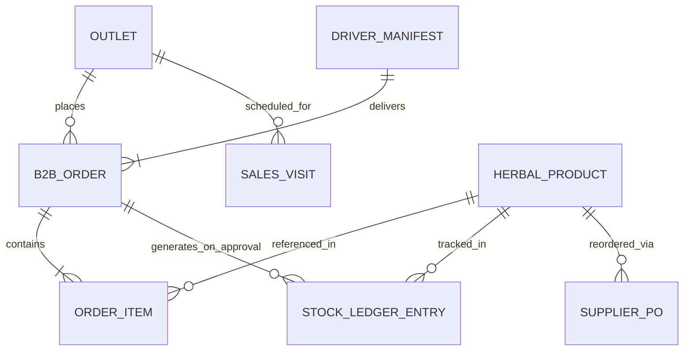

# 03 - Model Data & Inventaris Master Data

Dokumen ini mendokumentasikan seluruh skema antarmuka data (data types), hubungan antar-entitas (ERD), dan inventaris lengkap master mock data yang tersimpan secara terpusat pada [`js/data.js`](file:///home/sam/Code/arbaconnect/arbaconn/js/data.js) dan dikelola secara reaktif oleh [`js/store.js`](file:///home/sam/Code/arbaconnect/arbaconn/js/store.js).

---

## 1. Diagram Hubungan Entitas (ERD)



---

## 2. Definisi Skema Objek Data JavaScript

### A. Objek Produk Herbal (`HerbalProduct`)
Mewakili katalog SKU herbal utama yang diproduksi dan didistribusikan oleh CV Arba'in:

```javascript
{
  sku: 'SKU-ARB-MDR500',                                     // Kode unik SKU produk
  name: 'Madu Randu Murni 500g',                             // Nama dagang produk
  category: 'Madu Herbal',                                   // 'Madu Herbal' | 'Kapsul Herbal' | 'Minyak & Cairan' | 'Serbuk'
  stock: 1420,                                               // Saldo fisik aktual saat ini di Gudang Kartasura
  safetyStock: 180,                                          // Batas buffer pengaman (SS)
  rop: 320,                                                  // Ambang Reorder Point (ROP)
  ropFormula: 'd=20, L=7d, SS=180',                          // Visualisasi formula ROP
  activeBatch: 'BATCH-2026-MDR-08',                          // Nomor batch aktif saat ini
  fefoDate: '2027-08-15',                                    // Tanggal kedaluwarsa batch aktif
  fefoStatus: 'Aman (>6 Bulan)',                             // 'Aman (>6 Bulan)' | 'Mendekati ED (<3 Bulan)' | 'Kritis (<30 Hari)'
  status: 'optimal',                                         // 'optimal' | 'below-rop' | 'critical-expiry' | 'out-of-stock'
  unitPrice: 65000,                                          // Harga jual B2B per unit dalam Rupiah (IDR)
  icon: 'nutrition'                                          // Nama ikon Material Symbols Outlined
}
```

### B. Objek Buku Besar Mutasi Stok (`StockLedgerEntry`)
Pencatatan mutasi inventaris atomik yang tidak dapat diubah (*immutable ledger*):

```javascript
{
  id: 'LEDG-89210',                                          // Nomor unik transaksi
  timestamp: '28 Mar 2026 • 09:15:22 WIB',                   // Waktu kejadian transaksi
  docRef: 'PO-2026-03-SUP-01',                               // Referensi dokumen legal
  skuName: 'Madu Randu Murni 500g',                          // Nama produk
  skuCode: 'SKU-ARB-MDR500',                                 // Kode SKU produk
  batch: 'BATCH-2026-MDR-08',                                // Nomor batch yang dimutasi
  type: 'MASUK',                                             // 'MASUK' | 'KELUAR' | 'PENYESUAIAN' | 'RETUR'
  quantity: 500,                                             // Jumlah unit (+ untuk masuk, - untuk keluar)
  finalStock: 1420,                                          // Saldo fisik akhir produk setelah mutasi
  operator: 'Slamet Riadi',                                  // Nama petugas penanggung jawab
  operatorRole: 'Warehouse Inbound',                         // Jabatan/peran petugas
  hash: 'c84a...9df2'                                        // Potongan SHA-256 hash integritas data
}
```

### C. Objek Mitra Outlet B2B (`Outlet`)
Data pelanggan apotek, klinik, dan toko retail di wilayah Solo Raya:

```javascript
{
  id: 'AP-SLO-001',                                          // ID unik outlet di sistem
  code: 'AP-SLO-001',                                        // Kode outlet
  name: 'Apotek Kimia Farma Slamet Riyadi',                  // Nama resmi outlet
  address: 'Jl. Slamet Riyadi No. 245, Solo',                // Alamat lengkap
  city: 'Solo',                                              // 'Solo' | 'Sukoharjo' | 'Karanganyar' | 'Klaten' | 'Boyolali' | 'Sragen'
  cityName: 'Surakarta',                                     // Nama kota administratif
  type: 'Jaringan Farmasi',                                  // 'Apotek Mandiri' | 'Jaringan Farmasi' | 'Minimarket Luwes'
  picName: 'apt. Dewi Lestari, S.Farm',                      // Nama Apoteker Pengelola Apotek (APA)
  picRole: 'Apoteker Pengelola Apotek (APA)',                // Jabatan PIC
  picPhone: '6281234567890',                                 // Nomor kontak WhatsApp aktif
  salesRep: 'Budi Santoso',                                  // Sales yang ditugaskan
  salesArea: 'Solo Tengah',                                  // Sub-rayon wilayah sales
  terms: 'Net 30 Hari',                                      // 'Net 30 Hari' | 'Net 14 Hari' | 'COD'
  creditLimit: 15000000,                                     // Plafon kredit maksimal (IDR)
  creditUsed: 6750000,                                       // Kredit yang sedang digunakan (IDR)
  creditRemaining: 8250000,                                  // Sisa plafon kredit (creditLimit - creditUsed)
  creditStatus: 'Lancar',                                    // 'Lancar' | 'Perhatian' | 'Overdue'
  lastOrderDate: '28 Mar 2026',                              // Tanggal pesanan terakhir
  orderFrequency: 'Mingguan (4x/bln)',                       // Frekuensi rata-rata repeat order
  ytdTotal: 48650000,                                        // Akumulasi belanja tahunan berjalan (IDR)
  lastVisitDate: '26 Mar 2026',                              // Tanggal kunjungan sales terakhir
  visitNotes: '"Apoteker meminta penambahan display stand..."' // Catatan kunjungan
}
```

### D. Objek Pesanan Penjualan B2B (`B2BOrder`)
Transaksi pemesanan produk oleh apotek:

```javascript
{
  id: 'ord-7f3b89-20260328',                                 // ID transaksi pesanan
  clientUuid: 'ord-7f3b89-20260328',                         // UUID klien PWA
  outletId: 'AP-SLO-001',                                    // ID outlet pemesan
  outletName: 'Apotek Kimia Farma Slamet Riyadi',            // Nama outlet pemesan
  address: 'Jl. Slamet Riyadi No. 245, Solo',                // Alamat pengiriman
  city: 'Solo',                                              // Kota tujuan
  salesRep: 'Budi Santoso',                                  // Sales rep pembuat order
  salesRepId: 'REP-SR-04',                                   // ID sales rep
  orderTime: '08:45 WIB',                                    // Waktu pemesanan
  orderTimestamp: 1774662300000,                             // Timestamp integer
  totalAmount: 8450000,                                      // Total nominal pesanan (IDR)
  terms: 'Net 30 Hari',                                      // Termin pembayaran
  limitMax: 15000000,                                        // Plafon maksimal outlet
  limitRemaining: 8250000,                                   // Sisa plafon kredit saat order dibuat
  geofenceValid: true,                                       // Status keabsahan lokasi GPS sales
  geofenceCoords: '-7.5583, 110.8214 (Presisi 12m)',         // Titik koordinat GPS
  npwp: '01.324.891.4-528.000',                              // NPWP outlet
  status: 'PENDING',                                         // 'PENDING' | 'APPROVED' | 'REJECTED' | 'DISPATCHED'
  syncStatus: 'SYNCED_DEDUCTED',                             // 'SYNCED_DEDUCTED' | 'OFFLINE_QUEUED'
  priority: 'Tinggi',                                        // 'Normal' | 'Tinggi'
  items: [                                                   // Rincian produk yang dipesan
    {
      sku: 'SKU-ARB-MDR500',
      name: 'Madu Randu Murni 500g',
      qty: 60,
      price: 65000,
      allocatedBatch: 'BATCH-2026-MDR-08',
      fefoDate: '2027-08-15',
      fefoStatus: 'Aman (>6 Bulan)'
    }
  ]
}
```

---

## 3. Resolusi Inkonsistensi Data (Sanitasi Selesai)

Pada proses immersi ke Vanilla, seluruh inkonsistensi data historis yang tercatat di audit telah diperbaiki secara tuntas:

1. **Penyelarasan SKU Produk**:
   - Seluruh item pesanan (`orders.items[].sku`) diselaraskan 100% dengan SKU master produk pada [`js/data.js`](file:///home/sam/Code/arbaconnect/arbaconn/js/data.js):
     - `SKU-ARB-MDR500`: Madu Randu Murni 500g (Rp 65.000).
     - `SKU-ARB-MDR250`: Madu Randu Murni 250g (Rp 38.000).
     - `SKU-ARB-HBT100`: Habbatussauda Softgel 100s (Rp 85.000).
     - `SKU-ARB-KLS060`: Ekstrak Kulit Manggis Plus 60s (Rp 55.000).
     - `SKU-ARB-PRP010`: Propolis Trigona Drop 10ml (Rp 110.000).
     - `SKU-ARB-ZTN060`: Minyak Zaitun Tursina Extra Virgin 60ml (Rp 32.000).
     - `SKU-ARB-TMU050`: Kapsul Temulawak Curcuma 50s (Rp 45.000).
2. **Kesesuaian Kunci Asing Outlet (`outletId`)**:
   - Seluruh pesanan kini menunjuk langsung ke ID outlet yang valid di daftar master outlet (`AP-SLO-001`, `AP-SLO-014`, `AP-SKH-002`, `AP-KRA-004`, `AP-KRA-078`, `AP-BYL-003`).
3. **Koreksi Perhitungan Sisa Plafon Kredit**:
   - Ditegakkan formula konsisten pada seluruh data outlet:
     $$\mathbf{creditRemaining = creditLimit - creditUsed}$$
