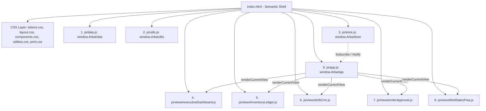

# 06 - Cetak Biru Arsitektur & Mesin Eksekusi Vanilla

Dokumen ini mendokumentasikan secara mendalam pola arsitektur perangkat lunak (*software architecture patterns*), mesin eksekusi logika (*runtime execution engine*), urutan pemuatan skrip, dan sistem perenderan komponen antarmuka yang diimplementasikan pada **ArbaConnect Pure Vanilla ERP**.

---

## 1. Arsitektur Komponen Tanpa Bundler (Zero-Bundler Architecture)

Untuk menjamin aplikasi dapat dieksekusi secara instan baik via protokol berkas lokal direct file system maupun server statis tanpa kendala *Cross-Origin Request (CORS)*, aplikasi mengadopsi pola **Global Namespaced Controller**:



### Urutan Pemuatan Skrip Deterministik di `index.html`:
1. [`js/data.js`](file:///home/sam/Code/arbaconnect/arbaconn/js/data.js): Menyediakan master data mentah awal (`products`, `ledger`, `outlets`, `orders`, `supplierPOs`, `salesVisits`, `driverManifests`).
2. [`js/utils.js`](file:///home/sam/Code/arbaconnect/arbaconn/js/utils.js): Menyediakan fungsi pembantu format Rupiah, format angka ribuan, sanitasi string HTML (`escapeHtml`), dan pengunduh CSV instan (`downloadCsv`).
3. [`js/store.js`](file:///home/sam/Code/arbaconnect/arbaconn/js/store.js): Menginisialisasi central state dari `localStorage` (atau fallback ke `ArbaData`), mendefinisikan seluruh fungsi mutasi bisnis, dan sistem observer Pub/Sub.
4. [`js/views/*.js`](file:///home/sam/Code/arbaconnect/arbaconn/js/views): Mendaftarkan fungsi perender view ke dalam objek kolektif `window.ArbaViews`.
5. [`js/app.js`](file:///home/sam/Code/arbaconnect/arbaconn/js/app.js): Mengikat seluruh event listener global, menghubungkan subscriber ke store, dan merender tampilan awal begitu DOM siap (`DOMContentLoaded`).

---

## 2. Pola Mesin State Reaktif (`js/store.js`)

Menggantikan fungsi `useState` dan `useContext` React dengan implementasi **Store Terpusat + Observer Pattern** murni:

```javascript
window.ArbaStore = (function() {
  const STORAGE_KEY = 'arbaconnect_erp_state_v2';

  // 1. Inisialisasi State dari localStorage
  function loadInitialState() {
    try {
      const saved = localStorage.getItem(STORAGE_KEY);
      if (saved) return JSON.parse(saved);
    } catch (e) {
      console.warn('Gagal membaca localStorage, memuat data inisial', e);
    }
    return JSON.parse(JSON.stringify(window.ArbaData));
  }

  const state = loadInitialState();
  const listeners = [];

  // 2. Persistensi Otomatis
  function persist() {
    try {
      localStorage.setItem(STORAGE_KEY, JSON.stringify(state));
    } catch (e) {
      console.error('Gagal menyimpan ke localStorage', e);
    }
  }

  // 3. Sistem Observer (Pub/Sub)
  function subscribe(listener) {
    listeners.push(listener);
    return function unsubscribe() {
      const idx = listeners.indexOf(listener);
      if (idx !== -1) listeners.splice(idx, 1);
    };
  }

  function notify() {
    persist();
    listeners.forEach(fn => fn(state));
  }

  // 4. Mutasi Bisnis Atomik (Contoh: Approve Order)
  function approveOrder(orderId) {
    const order = state.orders.find(o => o.id === orderId);
    if (!order || order.status !== 'PENDING') return;

    // A. Potong stok produk & validasi ROP
    order.items.forEach(item => {
      const prod = state.products.find(p => p.sku === item.sku);
      if (prod) {
        prod.stock = Math.max(0, prod.stock - item.qty);
        if (prod.stock <= prod.rop) prod.status = 'below-rop';
        
        // B. Catat mutasi atomik ke Buku Besar (Stock Ledger)
        state.ledger.unshift({
          id: `LEDG-${Math.floor(10000 + Math.random() * 90000)}`,
          timestamp: new Date().toLocaleDateString('id-ID', { day: '2-digit', month: 'short', year: 'numeric' }) + ' • ' +
                     new Date().toLocaleTimeString('id-ID') + ' WIB',
          docRef: order.clientUuid,
          skuName: prod.name,
          skuCode: prod.sku,
          batch: item.allocatedBatch || prod.activeBatch,
          type: 'KELUAR',
          quantity: -item.qty,
          finalStock: prod.stock,
          operator: 'Admin Sales Ops',
          operatorRole: 'Sales & Verification',
          hash: Math.random().toString(16).substring(2, 6) + '...' + Math.random().toString(16).substring(2, 6)
        });
      }
    });

    order.status = 'APPROVED';
    notify(); // Memicu re-render otomatis seluruh komponen yang berlangganan
  }

  return {
    getState: () => state,
    subscribe,
    notify,
    approveOrder,
    // ... mutasi bisnis lainnya
  };
})();
```

---

## 3. Pola Perenderan DOM & Navigasi Halaman (`js/app.js`)

Aplikasi mengarahkan pergantian halaman secara instan tanpa memuat ulang peramban (*Single Page Architecture*):

1. **Routing Berbasis State & Sinkronisasi URL Hash**:
   - `window.ArbaStore.setPath(newPath)` memperbarui nilai `state.currentPath` sekaligus menyelaraskan `window.location.hash = newPath`.
   - **Dukungan Tombol History Browser**: Pemasangan listener `window.addEventListener('hashchange', ...)` memastikan tombol *Back* dan *Forward* peramban berfungsi secara alami antar modul.
   - **Deep-Linking & Parameter Uji Visual**: Inisialisasi awal pada `loadInitialState()` membaca URL hash secara langsung (`#executive-dashboard`, `#inventory-stock-ledger`, `#b2b-crm-directory`, `#order-approval-queue`, `#field-sales-pwa-preview`) serta mendukung parameter override `?sidebar=expanded|collapsed` dan `?dark=true|false`.
   - Pemanggilan `notify()` memicu fungsi callback subscriber di `window.ArbaApp`.
   - `window.ArbaApp.renderCurrentView()` memeriksa `state.currentPath` dan mengeksekusi perender yang sesuai:
     ```javascript
     switch (state.currentPath) {
       case 'executive-dashboard':
         window.ArbaViews.renderExecutiveDashboard(container);
         break;
       case 'inventory-stock-ledger':
         window.ArbaViews.renderInventoryLedger(container);
         break;
       case 'b2b-crm-directory':
         window.ArbaViews.renderB2bCrm(container);
         break;
       case 'order-approval-queue':
         window.ArbaViews.renderOrderApproval(container);
         break;
       case 'field-sales-pwa-preview':
         window.ArbaViews.renderFieldSalesPwa(container);
         break;
     }
     ```
2. **Sinkronisasi Tata Letak Shell (`#app-content-wrapper`)**:
   - Fungsi `updateSidebarBadges(state)` menyinkronkan status sidebar dengan area konten utama:
     - Jika `state.isSidebarCollapsed` bernilai `false`, kelas `.sidebar-open` ditambahkan ke `#app-content-wrapper`.
     - Aturan CSS di [`css/layout.css`](file:///home/sam/Code/arbaconnect/arbaconn/css/layout.css) mentransisikan `padding-left` dari `64px` ke `256px` dengan kurva bezier halus, sementara lapisan backdrop dinonaktifkan pada desktop (`min-width: 1024px`) agar tidak menghalangi interaksi.
     - Pada layar mobile (`< 1024px`), `padding-left` dipertahankan `64px` dan navigasi modul secara otomatis melipat kembali sidebar drawer.
3. **Pencarian Live Cepat 3-Kategori**:
   - Event input pada `#global-search-input` memfilter outlet, produk herbal, dan faktur pesanan secara real-time.
   - Hasil pencarian diinjeksi ke elemen dropdown `#global-search-dropdown`.
   - Navigasi otomatis dan penutupan dropdown saat salah satu item hasil dipilih.
4. **Manajemen Dialog Modal Terpusat**:
   - `window.ArbaApp.openModal(htmlContent)`: Menginjeksi konten dialog ke dalam `#modal-container` dengan backdrop gelap.
   - `window.ArbaApp.closeModal()`: Mengosongkan kontainer modal.
   - Menekan tombol `Escape` atau mengklik backdrop di luar kartu modal otomatis menutup modal secara elegan.
5. **Notifikasi Toast Mengambang**:
   - `window.ArbaApp.showToast(message, icon)`: Menampilkan kartu umpan balik visual di pojok kanan bawah dengan durasi tayang otomatis 3,2 detik.

---

## 4. Ekspor Berkas CSV & Media Cetak Kertas

1. **Ekspor CSV Murni Tanpa Server**:
   - Diimplementasikan di [`js/utils.js`](file:///home/sam/Code/arbaconnect/arbaconn/js/utils.js) menggunakan API standar peramban `Blob` dan `URL.createObjectURL`.
   - Dilengkapi byte order mark UTF-8 (`\uFEFF`) agar berkas CSV langsung rapi saat dibuka di Microsoft Excel.
   - Tersedia 3 fungsi ekspor:
     - `exportExecutiveReportToCsv`: Laporan ringkasan KPI eksekutif dan pesanan.
     - `exportStockLedgerToCsv`: Seluruh rekaman mutasi buku besar stok.
     - `exportCrmToCsv`: Direktori lengkap mitra apotek B2B Solo Raya.
2. **Media Cetak Kertas Dokumen Legal**:
   - Menggunakan `@media print` murni pada [`css/print.css`](file:///home/sam/Code/arbaconnect/arbaconn/css/print.css).
   - Menghilangkan navigasi header, sidebar, dan tombol aksi sistem saat fungsi `window.print()` dipanggil.
   - Surat Jalan 3-rangkap diformat otomatis untuk kertas ukuran A4.
   - Struk kasir PWA diformat otomatis untuk kertas termal ukuran lebar 58mm.
